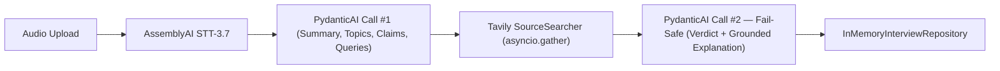

# Backend API Architecture

Architecture and HTTP contract for Griffier's FastAPI backend, aligned with [decisions 0001–0008](../decisions/README.md), [diagrams](../diagrams/), and the [prototype scope](../decisions/prototype-scope.md).

## Module Structure

```text
backend/src/griffier/
├── api/            # Thin FastAPI routers, HTTP schemas, exception handlers
├── domain/         # Pure Pydantic models (Interview, TranscriptSegment, Claim, ExternalSource) + Protocols
├── services/       # Use-case orchestration talking exclusively to Protocols
├── adapters/       # Concrete providers (AssemblyAI, PydanticAI, Tavily, InMemoryRepository)
├── config.py       # Typed environment settings (pydantic-settings)
└── dependencies.py # Single composition root wiring adapters via FastAPI Depends
```

- **`api/`** handles HTTP concerns only: multipart upload validation, status codes, dependency injection, and mapping domain errors to JSON responses.
- **`domain/`** defines Griffier's own data models (`Interview`, `TranscriptSegment`, `Claim`, `ExternalSource`, `AudioAsset`) and `Protocol` interfaces (`Transcriber`, `IntelligenceAnalyzer`, `SourceSearcher`, `InterviewRepository`, `AudioStore`) with zero external provider imports.
- **`services/`** coordinates end-to-end flows (`process_audio`, `mark_passage`, `remove_claim`) against protocols so business logic stays independent of vendors and HTTP.
- **`adapters/`** translates vendor payloads into Griffier domain models at the edge, ensuring no vendor-specific types leak inward.
- **`dependencies.py`** wires concrete adapters from `config.py` in one place, allowing providers to be swapped or faked cleanly.

## Passage-to-Claim Anchoring

Every `Claim` links back to the transcript through a deterministic anchor:

- **AI-suggested claims (`origin="ai"`):** Anchored by `segment_id` + `quote`. On the frontend, the quote is matched inside that segment (exact or normalized substring), falling back to highlighting the full segment if the LLM slightly paraphrases.
- **Journalist-marked passages (`origin="journalist"`):** Anchored by `segment_id`, `quote`, and character offsets (`start_offset`, `end_offset`) within that segment.

## Processing Flows

Detailed Mermaid sequence diagrams live in [`documentation/diagrams/`](../diagrams/).

### 1. Audio Ingestion (`POST /api/interviews`)

Both uploaded audio files and stopped browser recordings go through one endpoint ([0008](../decisions/0008-single-request-audio-processing.md)):



Every URL returned to the client comes directly from `SourceSearcher` results; Call #2 references retrieved snippets by ID (`[1]`, `[2]`), and Python attaches the real URLs so the LLM never constructs or copies links ([0006](../decisions/0006-tavily-for-external-source-search.md)).

### 2. Manual Passage Marking & Batch Fact-Check (`POST /api/interviews/{id}/claims/check`)

The journalist can mark one or more transcript passages in the UI (via right-click context menu or mobile fallback) without waiting on network calls between marks. Clicking the **Check marked passages** action sends the pending passages in one batch request (`POST /api/interviews/{id}/claims/check`): all claims are persisted immediately (`origin="journalist"`), then run through the same Tavily search + fail-safe source-grounded verification step to attach a verdict (`supported`, `contradicted`, `needs_context`, or `unverified`), grounded explanation, and real sources.

### 3. Audio Playback & Speaker Renaming

- `GET /api/interviews/{id}/audio` returns the audio bytes stored in `AudioStore` (backed by a bounded in-memory LRU cache in the prototype) with their original MIME type so the frontend playbar can play and seek through the interview. If an older interview's audio was evicted from the LRU cache, the endpoint returns `404` while the transcript, claims, and sources remain available.
- `PATCH /api/interviews/{id}/speakers` accepts a speaker rename mapping (e.g., `{"Speaker A": "Jan Peeters"}`) and updates all matching `TranscriptSegment` and `Claim` records in memory.

## Endpoints

| Method & Path | Purpose | Status Codes |
| :--- | :--- | :--- |
| `GET /api/health` | Liveness check | `200` |
| `GET /api/interviews` | List interviews in the current in-memory session | `200` |
| `POST /api/interviews` | Upload audio file or stopped recording; returns transcript, claims, and external sources | `201`, `400`, `413`, `415`, `502` |
| `GET /api/interviews/{id}` | Retrieve an existing interview by ID | `200`, `404` |
| `GET /api/interviews/{id}/audio` | Serve stored audio bytes for the transcript playbar | `200`, `404` |
| `PATCH /api/interviews/{id}/speakers` | Rename one or more speakers across segments and claims | `200`, `404`, `422` |
| `POST /api/interviews/{id}/claims/check` | Persist and fact-check a batch of journalist-marked passages | `201`, `404`, `422` |
| `DELETE /api/interviews/{id}/claims/{claim_id}` | Remove or dismiss a claim | `204`, `404` |

## Validation, Timeouts & Graceful Degradation

- **Upload guards:** Reject empty uploads (`400`), files over 25 MB (`413`), and unsupported audio MIME types (`415`). Accepted types include `audio/mpeg`, `audio/wav`, `audio/webm` (Chrome/Firefox `MediaRecorder`), `audio/mp4` / `audio/m4a` (Safari `MediaRecorder`), and `audio/ogg`.
- **Timeouts:** Configure generous end-to-end timeouts (120s on frontend `fetch`, Vite dev proxy, and backend `httpx` clients) to accommodate single-request STT + LLM + search runs.
- **Graceful degradation:**
  - In `POST /api/interviews`, once transcription succeeds, the interview is preserved even if one or more Tavily searches fail (`asyncio.gather(..., return_exceptions=True)`), returning a `warnings` list rather than discarding a completed transcript.
  - In `POST /api/interviews/{id}/claims/check`, all journalist-marked passages are persisted first; if enrichment or search fails for any item, the endpoint still returns `201` with the saved claims and warnings.
- **Consistent error responses:** Domain and upstream exceptions are caught by centralized FastAPI exception handlers and returned as structured JSON (`404` for unknown IDs, `502` when transcription fails) without exposing raw stack traces or vendor payloads.

## Testing Strategy

- Integration tests exercise the full HTTP layer using FastAPI's `TestClient` / `httpx.AsyncClient` with `app.dependency_overrides` injecting fake `Transcriber`, `SourceSearcher`, and `InterviewRepository` implementations.
- LLM orchestration tests use PydanticAI's `TestModel` and `FunctionModel`.
- Automated tests never call live external APIs.
