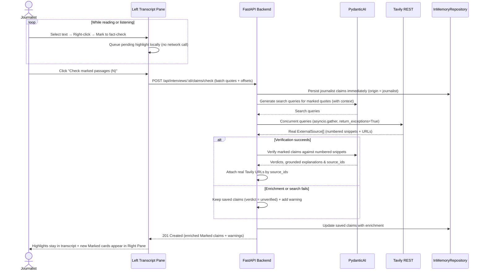

# Passage Marking & Batch Fact-Check Flow

Sequence for journalist-marked passages: instant local queuing via right-click, followed by one batch verification request (`POST /api/interviews/{id}/claims/check`).

